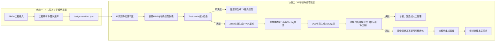

# FPGA IP 到 ASIC 行为级 RTL 替换系统开发方案

## 1. 文档目的

本文档定义一套面向 FPGA 数字 IP 的 RTL 转换系统。系统以验证为核心，将含有 Xilinx FPGA IP 的设计分解为可管理的替换任务，按照模块依赖关系自底向上，将 FPGA 专用模块逐步替换为厂商无关、面向 ASIC 综合的行为级 Verilog 实现。

系统不以“尽可能多地生成代码”为首要目标，而以“每个被接受的替换都有可重复的验证证据”为首要目标。无法自动替换或无法充分验证的模块必须停止自动提升，并输出人工处理报告。

## 2. 产品定位与边界

### 2.1 产品定位

系统定位为：

> 验证驱动的 FPGA 数字 IP 分解、行为级替换与 ASIC RTL 迁移平台。

核心能力包括：

1. 解析完整 FPGA RTL 工程及其层次结构。
2. 识别 Xilinx IP、基础原语和由 IP 生成器产生的模块。
3. 将整体设计分解为具有依赖关系的替换任务。
4. 检查每个待替换模块是否具有可复用 Testbench。
5. 使用 Xilinx 仿真工具建立原始 FPGA 实现的参考结果。
6. 使用 VCS 等 ASIC 仿真工具验证替换后的行为级实现。
7. 从叶子模块开始，逐层完成替换、验证和集成回归。
8. 对不能替换或不能验证的任务生成结构化报告。

### 2.2 支持范围

第一阶段重点支持以下数字 IP：

- BRAM、ROM、分布式 RAM。
- 同步 FIFO、异步 FIFO。
- DSP、乘法器、加法器、MAC、累加器。
- AXI4-Lite Interconnect、Crossbar。
- AXI4/AXI4-Lite Register Slice。
- AXI Data Width Converter。
- AXI Clock Converter。
- 常规 AXI 地址译码、仲裁和缓冲模块。
- 可以用可综合 RTL 准确描述的其他纯数字 IP。

### 2.3 不支持范围

以下模块不作为自动行为级替换目标：

- PLL、MMCM 等模拟或混合信号时钟 IP。
- DDR、PCIe、Ethernet 等 PHY。
- SERDES、ADC、DAC。
- FPGA 配置和启动控制模块。
- 加密且无法恢复功能配置的第三方 IP。
- 依赖特定 FPGA 器件模拟特性的模块。
- 只有 bitstream、没有 RTL、网表或配置数据的设计。

这些模块应被识别为边界节点，并进入人工处理任务列表。

## 3. 总体设计原则

### 3.1 验证先于替换

每个替换任务必须先通过 Testbench 准入检查。没有可复用 Testbench 的模块不能直接进入自动替换流程。

Testbench 准入至少要求：

- 能独立实例化待替换模块。
- 能稳定地完成时钟、复位和输入激励。
- 能在指定随机种子下重复运行。
- 能覆盖模块的主要功能模式。
- 能产生工具无关的标准结果或事务记录。
- 验证代码可以分别驱动原 FPGA 实现和 ASIC 替代实现。
- 不把 Xilinx 仿真库调用直接散布在公共激励和检查逻辑中。

系统可以生成 Testbench 骨架，但自动生成的骨架在人工补充功能场景并通过基准仿真前，不能标记为可复用 Testbench。

### 3.2 同一验证源，不同仿真后端

“统一验证代码”不要求原设计和替代设计在同一个仿真进程中运行。推荐结构为：

```text
公共验证源
├── 激励生成器
├── 协议驱动器
├── 监视器
├── 结果采集器
├── 比较规则
└── 测试用例与随机种子
        │
        ├── Xilinx DUT Adapter → Xilinx Simulator
        └── ASIC DUT Adapter   → VCS/其他 ASIC Simulator
```

公共验证源负责定义测试内容和结果语义；DUT Adapter 负责处理模块名、端口名、仿真库和编译选项的差异。

### 3.3 可综合实现优先使用 Verilog

替代 IP、兼容 Wrapper 和生成的可综合 RTL 原则上采用 Verilog-2001 风格，避免依赖 SystemVerilog 综合特性。

推荐使用：

- `wire`、`reg`。
- `always @(*)`。
- `always @(posedge clk or negedge rst_n)`。
- 非阻塞赋值描述时序逻辑。
- blocking 赋值描述组合逻辑。
- 参数化模块和标准 `generate`。
- 扁平化的 AXI 端口信号。

可综合代码中避免使用：

- `logic`、`always_ff`、`always_comb`。
- `interface`、`modport`。
- class、动态数组、queue、mailbox。
- SystemVerilog assertion。
- 依赖特定仿真器的系统任务。

Testbench 不受这一限制。验证代码可以使用两个仿真器都支持的 SystemVerilog 子集，必要时也可以使用 UVM，但必须把仿真器专用内容隔离在后端适配层中。

### 3.4 最小化修改上层设计

系统优先生成与原 IP 模块同名、同端口的兼容 Wrapper，而不是大规模改写用户顶层 RTL。例如：

```verilog
module design_axi_interconnect_0 (
    /* 保持原模块端口 */
);

portable_axi_interconnect #(
    .S_COUNT    (2),
    .M_COUNT    (4),
    .DATA_WIDTH (64),
    .ADDR_WIDTH (32)
) u_impl (
    /* 自动生成端口映射 */
);

endmodule
```

这种方法可以减小变更范围，并允许同一个上层 Testbench 在替换前后继续使用。

### 3.5 确定性转换

自动替换应由确定性规则、参数检查和模板生成完成。任何具有歧义的推断必须降级为人工确认，不允许在未报告的情况下猜测 IP 行为。

## 4. 系统总体架构

系统拆分为两个可以独立部署、独立演进的功能。RTL 提取功能不执行 IP 替换和仿真；IP 替换验证功能不解析 RTL 或重新提取子模块。两者只通过版本化的 `design-manifest.json` 连接。



功能一由以下组件构成：

1. 项目解析器。
2. RTL elaboration 和层次图构建器。
3. 标准设计清单输出器。

功能二由以下组件构成：

1. 设计清单读取与版本检查器。
2. FPGA IP 识别器和替换边界分析器。
3. 替换任务 DAG 构建器。
4. Testbench 管理器和任务调度器。
5. 行为级 IP 库和代码生成器。
6. Xilinx 与 VCS/ASIC 远程仿真后端。
7. 标准结果采集、比较、回归和报告系统。

## 5. 独立的 RTL 提取功能

### 5.1 工程输入

RTL 提取器应支持以下输入：

- Verilog/SystemVerilog 源文件。
- 头文件和 include 路径。
- 宏定义和编译顺序。
- 顶层模块名称。
- Vivado 工程文件和 Tcl 脚本。
- XCI、BD 等 Xilinx IP 配置文件。
- 仿真文件集合和综合文件集合。
- Xilinx 仿真库信息。

该功能只生成模块定义、实例关系、源文件位置和完整层次树，不识别替换任务，不调用 Testbench，也不连接仿真服务器。

其输出必须符合版本化的 `design-manifest.json` 接口。IP 替换验证工具只读取该接口，因此也可以使用原有 repo 的子模块提取功能代替本系统附带的参考提取器。

项目描述文件示例：

```yaml
project:
  name: demo_soc
  vendor: xilinx
  top: soc_top

sources:
  filelists:
    - rtl/files.f
  include_dirs:
    - rtl/include
  defines:
    - FPGA_BUILD

xilinx:
  project_file: vivado/demo_soc.xpr
  ip_dirs:
    - vivado/ip

verification:
  test_root: verification
  test_list: verification/tests.yaml
```

### 5.2 层次展开

解析器需要完成预处理、参数求值、generate 展开和模块实例绑定，输出实际设计层次，而不是只根据源文件中的模块定义建立关系。

每个实例节点至少记录：

- 层次路径。
- 模块定义。
- 源文件和行号。
- 实际参数值。
- 端口连接。
- 子实例列表。
- 是否为 Xilinx IP 或基础原语。
- 是否具有独立 Testbench。
- 是否存在厂商配置文件。
- 是否可作为独立替换边界。

### 5.3 依赖 DAG

模块实例关系被转换为依赖 DAG：

- 节点表示可替换模块或 IP。
- 边 `A → B` 表示模块 A 依赖子模块 B。
- 没有待替换子节点的节点为叶子替换任务。
- 调度器按逆拓扑顺序，从叶子向顶层处理。

设计层次树和替换任务 DAG 不完全相同。同一个参数化模块的多个实例可以：

- 在参数完全一致时合并为一个实现任务、多个实例回归任务。
- 在参数不同时拆分为不同的配置任务。
- 在上下文行为不同时保持实例级任务。

### 5.4 替换边界判定

系统应尽量向底层分解，但不能盲目拆到最小语法模块。替换边界应同时满足：

- 能明确描述输入输出接口。
- 能恢复完整功能参数。
- 能独立建立或复用 Testbench。
- 内部未包含必须整体处理的协议状态。
- 拆分后不会破坏原 IP 的原子语义。

例如：

- `RAMB36E1` 可以作为基础替换任务。
- 由多个 BRAM 组成的 Block Memory Generator，可以先替换底层 BRAM，也可以在有完整 XCI 配置时整体替换。
- AXI Interconnect 的仲裁器、地址译码器和缓冲器通常不应仅按语法模块任意拆开；若缺少内部接口级 Testbench，应把完整 Interconnect 作为验证边界。
- 加密 IP 内部不可见时，应把最外层可验证接口作为边界。

边界选择原则为：选择“最小的、功能完整且可独立验证”的模块。

## 6. 替换任务模型

### 6.1 任务数据结构

每个任务使用结构化描述：

```yaml
task_id: task_0042
instance: soc_top/u_subsys/u_bram
module: blk_mem_gen_0
kind: memory
vendor: xilinx

dependencies:
  - task_0038
  - task_0039

source:
  rtl: generated/blk_mem_gen_0.v
  config: vivado/ip/blk_mem_gen_0/blk_mem_gen_0.xci

replacement:
  strategy: portable_behavioral_model
  library_module: portable_true_dual_port_ram
  language: verilog

verification:
  testbench: verification/blk_mem_gen_0/tb_top.sv
  mode: cycle_exact
  tests:
    - basic_read_write
    - byte_enable
    - same_address_collision
  seeds:
    - 1
    - 17
    - 2026

status: discovered
```

### 6.2 任务状态机

推荐状态如下：

```text
DISCOVERED
  → TB_CHECK
  → BLOCKED_NO_TB 或 TB_READY
  → FPGA_BASELINE_RUNNING
  → FPGA_BASELINE_PASS
  → REPLACEMENT_READY
  → ASIC_SIM_RUNNING
  → ASIC_SIM_PASS
  → COMPARE_PASS
  → INTEGRATION_PASS
  → ACCEPTED
```

任一步失败进入对应失败状态，例如：

- `FPGA_BASELINE_FAIL`
- `ASIC_COMPILE_FAIL`
- `ASIC_SIM_FAIL`
- `COMPARE_FAIL`
- `INTEGRATION_FAIL`
- `MANUAL_REQUIRED`

只有 `ACCEPTED` 状态的任务才能作为已验证依赖被上层任务使用。

## 7. Testbench 准入与复用规范

### 7.1 Testbench 分层

推荐将验证环境拆成四层：

```text
verification/<module>/
├── common/
│   ├── testcases.sv
│   ├── stimulus.sv
│   ├── monitor.sv
│   ├── scoreboard.sv
│   └── trace_writer.sv
├── fpga/
│   ├── dut_adapter.v
│   └── xilinx_files.f
├── asic/
│   ├── dut_adapter.v
│   └── asic_files.f
├── config/
│   ├── tests.yaml
│   └── compare.yaml
└── tb_top.sv
```

其中：

- `common` 中的测试、激励、监视和检查逻辑被两个仿真后端共同使用。
- `fpga/dut_adapter.v` 实例化原 Xilinx IP。
- `asic/dut_adapter.v` 实例化行为级替代模块。
- 两个 Adapter 对 Testbench 暴露相同的逻辑接口。
- 编译脚本和仿真器专用选项不进入公共验证代码。

### 7.2 基准结果

原始 FPGA 仿真必须先通过，才能把输出作为参考。系统保存：

- 工程和源文件版本摘要。
- Xilinx 工具版本。
- IP 配置摘要。
- Testbench 版本。
- 测试名称和随机种子。
- 编译和运行参数。
- 标准化结果文件。
- assertion、error、warning 摘要。
- 可选覆盖率结果。

如果原始 FPGA Testbench 失败，替换任务必须停止，不能通过修改替代实现去迎合一个不稳定的参考结果。

### 7.3 两种比较机制

系统同时支持以下机制：

#### 自检查 Testbench

公共 scoreboard 在 Xilinx 和 ASIC 仿真中分别运行。两个环境都必须通过相同的功能断言和参考模型检查。

#### 标准化 Trace 比较

Xilinx 仿真生成 golden trace，ASIC 仿真生成 candidate trace，由独立比较器进行比较。

推荐标准 trace 使用逐行记录格式：

```json
{"event":"write","cycle":42,"addr":"00001000","data":"12345678","strb":"f"}
{"event":"read_rsp","cycle":57,"id":3,"data":"12345678","resp":0}
```

大型回归可以使用压缩 JSONL、CSV 或二进制事件格式，但必须保留统一的数据模型和版本号。

### 7.4 跨仿真器一致性要求

Xilinx 仿真和 VCS 可能在 delta cycle、未知值传播和未初始化状态方面存在差异。因此比较器必须：

- 在明确的时钟采样点记录结果。
- 统一 reset 释放时刻。
- 固定随机种子和测试向量。
- 明确区分 `0/1/X/Z`。
- 不默认把 `X` 当作任意通过值。
- 对协议事务进行标准化，避免比较无意义的 delta-cycle 差异。
- 记录仿真时间单位和时钟周期定义。

## 8. RTL 仿真结果的判定方式

所有替换验证都是 RTL 仿真：原 FPGA RTL 在 Xilinx 仿真器中运行，替换后的 RTL 在 VCS 中运行。下面的分类只表示 Testbench 和比较器如何判定两次 RTL 仿真的结果，并不表示采用了不同的仿真层次。

### 8.1 信号级周期精确比较（默认方式）

对同一组输入、时钟和复位，在预先定义的采样边沿比较原实现与替代实现的输出。适用于：

- 组合算术和逻辑单元。
- 固定流水线 DSP。
- BRAM、ROM 和同步 RAM。
- Register Slice。
- 同步 FIFO。

对于组合逻辑，在同一个有效输入采样点比较输出；对于时序逻辑，要求输出有效周期、控制信号和数据逐周期一致。

替代实现即使内部结构不同，对外可见的 pipeline 延迟也应与原设计一致。如果行为级核心的天然延迟不同，应由兼容 Wrapper 增加寄存器或控制逻辑，恢复原 IP 的外部时序。系统默认不把“固定延迟发生变化”认定为等价替换，因为这可能破坏上层 RTL。

### 8.2 协议级功能比较（用于 AXI 等握手接口）

AXI Interconnect、Crossbar、Width Converter 和 Clock Converter 仍然使用 RTL 仿真，只是 Testbench 通过 AXI monitor 和 scoreboard 比较完成的协议事务，而不是要求两边每一个周期的 `READY`、`VALID` 波形完全相同。

原因是 AXI 接口允许合法的 backpressure、buffering 和仲裁时序差异。例如两个正确的 Interconnect 可以在不同周期拉高 `READY`，但都必须完成相同的读写请求。

协议级检查至少包括：

- 请求不丢失、不重复。
- 地址、数据、byte strobe 和 response 正确。
- ID 和事务响应正确关联。
- 每个 ID 内的顺序符合配置和协议要求。
- burst 拆分、合并和宽度转换正确。
- backpressure 下不发生数据损坏。
- 不产生死锁。
- 所有被接受的请求最终产生合法响应。

协议允许变化的只有握手和响应时间；数据内容、地址映射、顺序约束和外部协议行为仍必须一致。如果原设计规范明确要求固定响应周期，则该任务仍应采用周期精确比较。

### 8.3 公共自检查 Testbench

无论采用信号级还是协议级判定，优先使用同一套公共 Testbench、测试向量、随机种子、monitor、scoreboard 和功能参考模型分别运行两个 DUT。Golden trace 与 candidate trace 是跨仿真器保存证据和辅助定位差异的手段，不是替代 RTL Testbench。

### 8.4 MANUAL：人工验证

如果既不能定义稳定的信号级比较规则，也不能定义完整的协议级 scoreboard，任务应标记为人工验证，不得显示为自动验证通过。

## 9. 自底向上的替换流程

### 9.1 可移植闭包

定义模块的“可移植闭包”状态：

一个模块只有在以下条件全部满足时，才是 ASIC 仿真器可独立编译和验证的：

1. 模块自身不再依赖未处理的 Xilinx 专用实现。
2. 所有子模块均已替换为可移植 Verilog，或者已声明为允许保留的 ASIC 黑盒。
3. 所需行为模型可以被 VCS 编译。
4. 模块的 Testbench 已通过准入检查。

叶子模块完成替换后，可移植闭包向父节点扩展。该机制决定何时可以在 VCS 中验证更高层模块。

### 9.2 单个任务执行步骤

每个任务执行以下固定流程：

1. 检查所有子任务是否已经接受。
2. 检查 Testbench 是否可复用。
3. 使用 Xilinx 仿真器运行原始实现。
4. 保存 golden trace、自检查结果和运行环境摘要。
5. 从统一 IP 参数中选择行为级 Verilog 实现。
6. 生成兼容 Wrapper 和 ASIC filelist。
7. 执行 Verilog lint 和基础编译检查。
8. 使用 VCS 运行相同测试集合和随机种子。
9. 根据任务声明的 RTL 仿真结果比较策略判定结果。
10. 运行替换后模块的完整回归。
11. 将替代模块临时加入父模块，执行最近一级集成冒烟测试。
12. 验证通过后接受替换，并重新计算父节点的可移植闭包。

### 9.3 混合实现验证

已生成的替代模块是普通 Verilog，因此可以在条件允许时放回 Xilinx 仿真环境，与尚未替换的 Xilinx IP 一起运行。这种混合仿真可用于尽早发现集成问题。

但混合仿真不能替代 VCS 验证。正式接受条件仍应包括：

- 原实现在 Xilinx 仿真器中通过。
- 替代实现或其当前可移植闭包在 VCS 中通过。
- 两端标准化结果满足声明的比较规则。

### 9.4 父模块回归

接受叶子替换后，至少运行两类回归：

- 当前任务的模块级完整回归。
- 最近可验证父模块的集成冒烟回归。

当父模块的所有依赖完成后，再运行父模块完整回归。这样可以避免在顶层全部替换结束后才发现早期集成错误。

## 10. IP 行为级库要求

### 10.1 通用要求

每个替代 IP 必须同时提供：

- 可综合 Verilog 实现。
- 参数约束和非法组合检查。
- 功能说明。
- 支持和不支持的配置列表。
- 独立 Testbench。
- 针对 Xilinx 参考实现的验证记录。
- 预期的 RTL 仿真结果比较策略。
- 已知差异和人工确认项。

### 10.2 BRAM 和 FIFO

需要明确支持：

- Single Port、Simple Dual Port、True Dual Port。
- 同步或异步读。
- read-first、write-first、no-change。
- byte enable。
- 输出寄存器和读延迟。
- 初始化文件。
- 同地址双端口访问。
- reset 对存储体或输出寄存器的影响。
- FIFO 的 first-word fall-through 模式。
- almost full、almost empty 和计数输出。
- 异步 FIFO 的跨时钟同步行为。

如果 Xilinx 模型把某种碰撞定义为未知，替代模型不得自行给出确定值来掩盖差异。

### 10.3 DSP

需要提取并验证：

- 输入和输出位宽。
- signed/unsigned。
- pre-adder、multiplier、post-adder 模式。
- 截断、舍入、饱和或回绕。
- pipeline 级数。
- clock enable。
- 同步或异步 reset。
- cascade 使用方式。

不能仅根据模块名称把 DSP 无条件改写成 `a * b + c`。

### 10.4 AXI

需要区分：

- AXI4、AXI4-Lite、AXI3、AXI-Stream。
- 地址、数据和 ID 宽度。
- burst 类型和最大长度。
- outstanding 数量。
- narrow 和 unaligned transfer。
- 仲裁策略。
- 地址映射。
- 通道 buffering。
- clock domain。
- 数据宽度转换规则。

AXI 替代模块原则上采用扁平 Verilog 端口，不依赖 SystemVerilog `interface`。

## 11. 仿真后端设计

### 11.1 统一后端接口

每个仿真后端实现统一接口：

```text
prepare(task, test)
compile(task, test)
elaborate(task, test)
run(task, test, seed)
collect_result(task, test, seed)
collect_coverage(task, test, seed)
```

统一返回：

- 成功或失败状态。
- 日志路径。
- error 和 warning 摘要。
- trace 路径。
- 覆盖率路径。
- 工具版本和运行参数。

### 11.2 Xilinx 后端

Xilinx 后端负责：

- 编译原始 FPGA RTL 和 Xilinx 仿真模型。
- 使用 Vivado/XSim 工具链进行 elaboration 和仿真。
- 保留 Vivado 工程定义的宏、include、IP 库和编译顺序。
- 生成原实现的 golden trace。

后端应通过脚本适配器封装 `xvlog`、`xelab`、`xsim` 或 Vivado batch flow，主调度器不直接拼接工具命令。

### 11.3 ASIC 后端

第一版 ASIC 后端以 VCS 为主，负责：

- 编译行为级 Verilog、ASIC Adapter 和公共 Testbench。
- 使用与 Xilinx 基准相同的测试列表和随机种子。
- 生成 candidate trace。
- 输出编译、仿真和覆盖率结果。

接口设计应允许后续增加其他 ASIC 仿真器，而不修改任务模型。

## 12. 调度算法

任务调度器的基本逻辑如下：

```text
build_dependency_dag()

while unfinished_tasks_exist:
    ready_tasks = tasks_whose_dependencies_are_accepted()

    for task in ready_tasks:
        if not reusable_testbench_exists(task):
            mark_blocked_no_tb(task)
            continue

        if not fpga_baseline_passes(task):
            mark_fpga_baseline_fail(task)
            continue

        replacement = resolve_or_generate_replacement(task)
        if replacement is unavailable:
            mark_manual_required(task)
            continue

        if not asic_simulation_passes(task, replacement):
            mark_asic_sim_fail(task)
            continue

        if not comparison_passes(task):
            mark_compare_fail(task)
            continue

        if not nearest_parent_smoke_test_passes(task):
            mark_integration_fail(task)
            continue

        accept(task)
        update_portable_closure(task.parents)
```

如果所有剩余任务都被阻塞，调度器停止，并输出阻塞链条，不能无限重试。

## 13. 输出物

建议输出目录如下：

```text
build/<project>/
├── analysis/
│   ├── hierarchy.json
│   ├── dependency_dag.json
│   ├── ip_inventory.json
│   └── replacement_plan.html
├── tasks/
│   └── <task_id>/
│       ├── task.yaml
│       ├── original/
│       ├── replacement/
│       ├── fpga_sim/
│       ├── asic_sim/
│       └── compare/
├── rtl/
│   ├── portable_ip/
│   ├── generated_wrappers/
│   └── converted_project/
├── verification/
│   ├── golden_traces/
│   ├── candidate_traces/
│   └── regressions/
└── reports/
    ├── summary.html
    ├── manual_required.html
    ├── unsupported_ip.html
    └── verification_evidence.html
```

## 14. 报告要求

### 14.1 项目级报告

项目级报告至少包含：

- 总模块数和总实例数。
- FPGA IP 数量和类型分布。
- 替换任务 DAG。
- 已接受、失败、阻塞和人工处理任务数量。
- 当前最高可移植层次。
- 顶层是否已经形成完整可移植闭包。
- 所有仿真工具和版本。
- 所有自动替换的验证证据索引。

### 14.2 任务级报告

每个任务至少记录：

- 原实例和层次路径。
- 原 IP 类型、版本和参数。
- 识别置信度。
- 替换实现和版本。
- Testbench 准入结果。
- Xilinx 基准仿真结果。
- VCS 仿真结果。
- RTL 仿真结果比较策略和比较结果。
- 运行测试、随机种子和覆盖率。
- 已知差异。
- 是否完成父模块集成验证。

### 14.3 人工处理报告

人工任务报告必须说明：

- 无法替换还是无法验证。
- 缺失的配置、源码或 Testbench。
- 未支持的具体功能参数。
- 受影响的父模块和顶层功能。
- 建议的人工替代接口。
- 自动生成的 Verilog 空壳和端口定义。
- 完成人工处理后应重新执行的回归集合。

## 15. 推荐工程目录

```text
fpga-ip-converter/
├── frontend/
│   ├── verilog/
│   ├── vivado_project/
│   └── xilinx_ip/
├── hierarchy/
│   ├── elaborator/
│   ├── dependency_graph/
│   └── boundary_analyzer/
├── recognizer/
│   ├── primitive_rules/
│   ├── ip_rules/
│   └── configuration_parsers/
├── task/
│   ├── model/
│   ├── scheduler/
│   └── state_store/
├── library/
│   ├── memory/
│   ├── fifo/
│   ├── dsp/
│   └── axi/
├── generator/
│   ├── wrapper/
│   ├── verilog/
│   └── filelist/
├── verification/
│   ├── testbench_manager/
│   ├── trace/
│   ├── comparator/
│   └── regression/
├── simulator/
│   ├── xilinx/
│   ├── vcs/
│   └── common/
├── report/
├── cli/
└── tests/
```

## 16. 命令行接口建议

```bash
# 功能一：独立生成RTL设计清单；已有提取器可替代此命令
rtl-manifest -c project.toml

# 功能二：只读取设计清单，生成IP替换任务DAG
ipverify -c project.toml plan

# 检查所有任务的Testbench准入状态
ipverify -c project.toml check-tb

# 为指定任务生成Xilinx基准结果
ipverify -c project.toml baseline task_0042

# 替换并验证指定任务
ipverify -c project.toml replace task_0042

# 自底向上自动处理所有当前可执行任务
ipverify -c project.toml run

# 生成项目级报告
ipverify -c project.toml report
```

## 17. MVP 开发计划

### 阶段一：验证基础设施

目标：先证明同一验证源能够跨 Xilinx 仿真器和 VCS 稳定工作。

交付内容：

- Testbench 目录和接口规范。
- Xilinx 仿真后端。
- VCS 仿真后端。
- 标准 trace 格式。
- RTL 仿真的信号级和协议级比较器。
- 运行环境与证据归档。

验收条件：

- 同一组测试和种子可以在两个后端运行。
- 人为注入的功能差异能够被比较器检测。
- 仿真结果可以重复生成。

### 阶段二：项目解析与任务 DAG

交付内容：

- Vivado 工程和 filelist 导入。
- 模块层次展开。
- Xilinx IP 和原语识别。
- 替换边界分析。
- 自底向上的任务调度器。
- Testbench 缺失和阻塞链报告。

验收条件：

- 能从代表性工程生成稳定、可追溯的任务 DAG。
- 所有任务都能关联回源文件、实例路径和配置文件。

### 阶段三：BRAM、FIFO 和 DSP

交付内容：

- 基础行为级 Verilog 库。
- XCI 参数到统一参数的转换规则。
- 兼容 Wrapper 生成。
- 周期精确 RTL 验证；若内部实现延迟不同，由兼容 Wrapper 恢复原 IP 的外部时序。

验收条件：

- 所有宣称支持的参数组合都有独立回归。
- 自动接受的每个替换都有 Xilinx/VCS 对比证据。

### 阶段四：AXI 基础模块

建议顺序：

1. AXI Register Slice。
2. AXI4-Lite Interconnect。
3. AXI Data Width Converter。
4. AXI Clock Converter。
5. 受限配置的 AXI4 Crossbar/Interconnect。

交付内容：

- AXI 公共驱动器和监视器。
- 事务级 trace。
- ID、顺序、burst、backpressure 和死锁检查。
- AXI 支持能力矩阵。

### 阶段五：父模块和顶层闭包

交付内容：

- 混合实现回归。
- 父模块自动回归。
- 可移植闭包计算。
- 顶层可移植 Verilog 工程输出。
- 完整人工处理报告。

## 18. 主要风险及控制措施

### 18.1 Testbench 存在但验证能力不足

控制措施：

- 为每类 IP 定义最低测试场景和覆盖要求。
- 对 Testbench 做故障注入或 mutation test，确认错误能被检测。
- 不以“仿真运行结束”作为验证通过标准。

### 18.2 两个仿真器产生表面差异

控制措施：

- 使用时钟边沿或事务边界采样。
- 标准化 X/Z 和时间语义。
- 把仿真器专用模型限制在 Adapter 内。
- 记录全部工具版本和编译选项。

### 18.3 过度拆分导致无法独立验证

控制措施：

- 以“最小功能完整、可独立验证模块”为拆分边界。
- 同时保留实例层次图和替换任务 DAG。
- 允许将多个底层节点合并成一个复合替换任务。

### 18.4 AXI 实现并非周期精确

控制措施：

- 明确使用事务级等价。
- 对 ordering、ID、burst 和 backpressure 建立独立检查器。
- 报告中明确说明允许的时序差异。

### 18.5 累积替换错误在高层才暴露

控制措施：

- 每次接受叶子替换后运行最近父模块的冒烟测试。
- 父模块形成可移植闭包后立即运行完整 VCS 回归。
- 保存每个接受点，支持回退到最近通过状态。

## 19. 最终验收定义

一个项目只有同时满足以下条件，才能标记为“自动转换完成”：

1. 顶层设计已经形成完整可移植闭包。
2. 所有自动替换任务都有可复用 Testbench。
3. 原实现在 Xilinx 仿真器中的基准测试全部通过。
4. 替代实现在 VCS 中的对应测试全部通过。
5. 所有任务通过其声明的 RTL 仿真结果判定规则。
6. 所有父模块和顶层集成回归通过。
7. 输出 RTL 的可综合部分符合约定的 Verilog 编码子集。
8. 不存在未披露的 Xilinx 原语或 IP 依赖。
9. 所有允许保留的黑盒和人工处理模块均被明确列出。
10. 工具版本、测试、种子、日志和比较证据均可追溯。

如果顶层仍包含人工任务，系统应输出“部分转换完成”，并明确当前最高可移植层次和剩余阻塞链，而不是给出误导性的成功结论。
