# FPGA IP to ASIC Behavioral RTL Replacement System — Design Plan

## 1. Purpose of this document

This document defines an RTL conversion system for FPGA digital IP. The system is verification-centric: it decomposes a design containing Xilinx FPGA IP into manageable replacement tasks, and, following the module dependency order bottom-up, progressively replaces FPGA-specific modules with vendor-neutral, ASIC-synthesis-oriented behavioral Verilog implementations.

The primary goal of the system is not "generate as much code as possible", but "every accepted replacement has reproducible verification evidence". Modules that cannot be replaced automatically, or that cannot be verified adequately, must stop automatic promotion and produce a manual-handling report.

## 2. Product positioning and boundaries

### 2.1 Product positioning

The system is positioned as:

> A verification-driven platform for FPGA digital IP decomposition, behavioral replacement, and ASIC RTL migration.

Core capabilities include:

1. Parse a complete FPGA RTL project and its hierarchy.
2. Recognize Xilinx IP, base primitives, and modules produced by IP generators.
3. Decompose the overall design into replacement tasks with dependencies.
4. Check whether every module to be replaced has a reusable testbench.
5. Use Xilinx simulation tools to establish the reference result of the original FPGA implementation.
6. Use ASIC simulators such as VCS to verify the behavior of the replacement implementation.
7. Starting from leaf modules, complete replacement, verification, and integration regression layer by layer.
8. Produce a structured report for tasks that cannot be replaced or cannot be verified.

### 2.2 Supported scope

Phase one focuses on the following digital IP:

- BRAM, ROM, distributed RAM.
- Synchronous FIFO, asynchronous FIFO.
- DSP, multipliers, adders, MAC, accumulators.
- AXI4-Lite Interconnect, Crossbar.
- AXI4/AXI4-Lite Register Slice.
- AXI Data Width Converter.
- AXI Clock Converter.
- Conventional AXI address decoding, arbitration, and buffering modules.
- Other purely digital IP that can be described accurately in synthesizable RTL.

### 2.3 Unsupported scope

The following modules are not targets for automatic behavioral replacement:

- Analog or mixed-signal clock IP such as PLL and MMCM.
- PHYs such as DDR, PCIe, and Ethernet.
- SERDES, ADC, DAC.
- FPGA configuration and startup control modules.
- Third-party IP that is encrypted and whose functional configuration cannot be recovered.
- Modules that depend on device-specific analog characteristics of a particular FPGA.
- Designs for which only a bitstream exists, with no RTL, netlist, or configuration data.

These modules should be recognized as boundary nodes and moved into the manual-handling task list.

## 3. Overall design principles

### 3.1 Verification before replacement

Every replacement task must first pass a testbench admission check. Modules without a reusable testbench cannot enter the automatic replacement flow directly.

Testbench admission requires at least:

- The module under replacement can be instantiated standalone.
- Clock, reset, and input stimulus can be driven reliably.
- Runs can be repeated under a specified random seed.
- The major functional modes of the module can be covered.
- Tool-independent standard results or transaction records can be produced.
- The verification code can drive the original FPGA implementation and the ASIC replacement implementation separately.
- Xilinx simulation library calls are not scattered directly through the shared stimulus and checking logic.

The system may generate a testbench skeleton, but an automatically generated skeleton must not be marked as a reusable testbench until functional scenarios have been added manually and it has passed a baseline simulation.

### 3.2 One verification source, different simulation backends

"Unified verification code" does not require the original design and the replacement design to run in the same simulation process. The recommended structure is:

```text
Common verification source
├── stimulus generator
├── protocol driver
├── monitor
├── result collector
├── comparison rules
└── testcases and random seeds
        │
        ├── Xilinx DUT adapter → Xilinx simulator
        └── ASIC DUT adapter   → VCS/other ASIC simulator
```

The common verification source defines the test content and the result semantics; the DUT adapter handles differences in module names, port names, simulation libraries, and compile options.

### 3.3 Prefer Verilog for synthesizable implementations

Replacement IP, compatible wrappers, and generated synthesizable RTL should in principle use Verilog-2001 style, avoiding dependence on SystemVerilog synthesis features.

Recommended:

- `wire`, `reg`.
- `always @(*)`.
- `always @(posedge clk or negedge rst_n)`.
- Non-blocking assignments for sequential logic.
- Blocking assignments for combinational logic.
- Parameterized modules and standard `generate`.
- Flattened AXI port signals.

Avoid in synthesizable code:

- `logic`, `always_ff`, `always_comb`.
- `interface`, `modport`.
- classes, dynamic arrays, queues, mailboxes.
- SystemVerilog assertions.
- Simulator-specific system tasks.

Testbenches are not subject to this restriction. Verification code may use the SystemVerilog subset supported by both simulators, and may use UVM when necessary, but simulator-specific content must be isolated in the backend adaptation layer.

### 3.4 Minimize changes to the upper-level design

The system prefers generating a compatible wrapper with the same module name and the same ports as the original IP module, rather than extensively rewriting the user's top-level RTL. For example:

```verilog
module design_axi_interconnect_0 (
    /* keep the original module ports */
);

portable_axi_interconnect #(
    .S_COUNT    (2),
    .M_COUNT    (4),
    .DATA_WIDTH (64),
    .ADDR_WIDTH (32)
) u_impl (
    /* automatically generated port mapping */
);

endmodule
```

This approach reduces the scope of change and allows the same upper-level testbench to continue to be used before and after replacement.

### 3.5 Deterministic conversion

Automatic replacement should be performed by deterministic rules, parameter checks, and template generation. Any ambiguous inference must be downgraded to manual confirmation; guessing IP behavior without reporting it is not allowed.

## 4. Overall system architecture

The system is split into two capabilities that can be deployed and evolved independently. RTL extraction does not perform IP replacement or simulation; IP replacement verification does not parse RTL or re-extract submodules. The two are connected only through the versioned `design-manifest.json`.

```mermaid
flowchart LR
    subgraph EXTRACT["Capability 1: RTL hierarchy and submodule extraction"]
        A["FPGA project input"] --> B["Project parsing and hierarchy elaboration"]
        B --> B2["design-manifest.json"]
    end
    subgraph VERIFY["Capability 2: IP replacement and remote verification"]
        C["IP recognition and boundary decision"] --> D["Dependency DAG and replacement task list"]
        D --> E["Testbench admission check"]
        E -->|"not satisfied"| M["Block and generate TB completion tasks"]
        E -->|"satisfied"| F["Xilinx simulation produces the FPGA baseline"]
        F --> G["Generate or select a behavioral Verilog implementation"]
        G --> H["VCS simulation produces the ASIC result"]
        H --> I["RTL simulation result comparison (signal / transaction level)"]
        I -->|"fail"| N["Diagnose, roll back, or handle manually"]
        I -->|"pass"| J["Accept the replacement and update the portable closure"]
        J --> K["Parent module integration verification"]
        K --> L["Continue with higher-level tasks"]
    end
    B2 --> C
```



Capability one consists of the following components:

1. Project parser.
2. RTL elaboration and hierarchy graph builder.
3. Standard design manifest emitter.

Capability two consists of the following components:

1. Design manifest reader and version checker.
2. FPGA IP recognizer and replacement boundary analyzer.
3. Replacement task DAG builder.
4. Testbench manager and task scheduler.
5. Behavioral IP library and code generator.
6. Xilinx and VCS/ASIC remote simulation backends.
7. Standard result collection, comparison, regression, and reporting system.

## 5. Standalone RTL extraction capability

### 5.1 Project inputs

The RTL extractor should support the following inputs:

- Verilog/SystemVerilog source files.
- Header files and include paths.
- Macro definitions and compile order.
- Top module name.
- Vivado project files and Tcl scripts.
- Xilinx IP configuration files such as XCI and BD.
- Simulation file sets and synthesis file sets.
- Xilinx simulation library information.

This capability only produces module definitions, instance relationships, source file locations, and the complete hierarchy tree. It does not recognize replacement tasks, does not invoke testbenches, and does not connect to simulation servers.

Its output must conform to the versioned `design-manifest.json` interface. The IP replacement verification tool only reads that interface, so an existing repository's submodule extraction capability may also be used in place of the reference extractor bundled with this system.

Example project description file:

```yaml
project:
  name: demo_soc
  vendor: xilinx
  top: soc_top

sources:
  filelists:
    - rtl/files.f
  include_dirs:
    - rtl/include
  defines:
    - FPGA_BUILD

xilinx:
  project_file: vivado/demo_soc.xpr
  ip_dirs:
    - vivado/ip

verification:
  test_root: verification
  test_list: verification/tests.yaml
```

### 5.2 Hierarchy elaboration

The parser needs to perform preprocessing, parameter evaluation, `generate` expansion, and module instance binding, and output the actual design hierarchy rather than establishing relationships only from the module definitions present in the source files.

Each instance node records at least:

- Hierarchy path.
- Module definition.
- Source file and line number.
- Actual parameter values.
- Port connections.
- List of child instances.
- Whether it is Xilinx IP or a base primitive.
- Whether it has a standalone testbench.
- Whether a vendor configuration file exists.
- Whether it can serve as an independent replacement boundary.

### 5.3 Dependency DAG

Module instance relationships are converted into a dependency DAG:

- Nodes represent replaceable modules or IP.
- An edge `A → B` means module A depends on submodule B.
- Nodes with no child node to be replaced are leaf replacement tasks.
- The scheduler processes in reverse topological order, from leaves toward the top.

The design hierarchy tree and the replacement task DAG are not exactly the same. Multiple instances of the same parameterized module can:

- Be merged into one implementation task with multiple instance regression tasks when the parameters are exactly identical.
- Be split into different configuration tasks when the parameters differ.
- Remain as instance-level tasks when the context behavior differs.

### 5.4 Replacement boundary decision

The system should decompose as far down as possible, but must not blindly split down to the smallest syntactic module. A replacement boundary should satisfy all of:

- Its input/output interface can be described unambiguously.
- Its complete functional parameters can be recovered.
- A testbench can be established or reused independently.
- It does not internally contain protocol state that must be handled as a whole.
- Splitting it does not destroy the atomic semantics of the original IP.

For example:

- `RAMB36E1` can serve as a base replacement task.
- A Block Memory Generator composed of multiple BRAMs can have its underlying BRAMs replaced first, or can be replaced as a whole when the full XCI configuration is available.
- The arbiter, address decoder, and buffers of an AXI Interconnect should generally not be split apart arbitrarily by syntactic module; if there is no internal interface-level testbench, the complete Interconnect should be used as the verification boundary.
- When the internals of encrypted IP are not visible, the outermost verifiable interface should be used as the boundary.

The boundary selection principle is: choose the "smallest module that is functionally complete and independently verifiable".

## 6. Replacement task model

### 6.1 Task data structure

Each task uses a structured description:

```yaml
task_id: task_0042
instance: soc_top/u_subsys/u_bram
module: blk_mem_gen_0
kind: memory
vendor: xilinx

dependencies:
  - task_0038
  - task_0039

source:
  rtl: generated/blk_mem_gen_0.v
  config: vivado/ip/blk_mem_gen_0/blk_mem_gen_0.xci

replacement:
  strategy: portable_behavioral_model
  library_module: portable_true_dual_port_ram
  language: verilog

verification:
  testbench: verification/blk_mem_gen_0/tb_top.sv
  mode: cycle_exact
  tests:
    - basic_read_write
    - byte_enable
    - same_address_collision
  seeds:
    - 1
    - 17
    - 2026

status: discovered
```

### 6.2 Task state machine

The recommended states are:

```text
DISCOVERED
  → TB_CHECK
  → BLOCKED_NO_TB or TB_READY
  → FPGA_BASELINE_RUNNING
  → FPGA_BASELINE_PASS
  → REPLACEMENT_READY
  → ASIC_SIM_RUNNING
  → ASIC_SIM_PASS
  → COMPARE_PASS
  → INTEGRATION_PASS
  → ACCEPTED
```

Any step that fails enters the corresponding failure state, for example:

- `FPGA_BASELINE_FAIL`
- `ASIC_COMPILE_FAIL`
- `ASIC_SIM_FAIL`
- `COMPARE_FAIL`
- `INTEGRATION_FAIL`
- `MANUAL_REQUIRED`

Only tasks in the `ACCEPTED` state may be used as verified dependencies by higher-level tasks.

## 7. Testbench admission and reuse specification

### 7.1 Testbench layering

The verification environment should preferably be split into four layers:

```text
verification/<module>/
├── common/
│   ├── testcases.sv
│   ├── stimulus.sv
│   ├── monitor.sv
│   ├── scoreboard.sv
│   └── trace_writer.sv
├── fpga/
│   ├── dut_adapter.v
│   └── xilinx_files.f
├── asic/
│   ├── dut_adapter.v
│   └── asic_files.f
├── config/
│   ├── tests.yaml
│   └── compare.yaml
└── tb_top.sv
```

Where:

- The tests, stimulus, monitoring, and checking logic in `common` are shared by both simulation backends.
- `fpga/dut_adapter.v` instantiates the original Xilinx IP.
- `asic/dut_adapter.v` instantiates the behavioral replacement module.
- Both adapters expose the same logical interface to the testbench.
- Compile scripts and simulator-specific options do not enter the common verification code.

### 7.2 Baseline result

The original FPGA simulation must pass first before its output can be used as a reference. The system stores:

- Project and source file version digest.
- Xilinx tool version.
- IP configuration digest.
- Testbench version.
- Test names and random seeds.
- Compile and run parameters.
- Standardized result files.
- Summary of assertions, errors, and warnings.
- Optional coverage results.

If the original FPGA testbench fails, the replacement task must stop; it is not allowed to accommodate an unstable reference result by modifying the replacement implementation.

### 7.3 Two comparison mechanisms

The system supports both of the following mechanisms:

#### Self-checking testbench

The common scoreboard runs in the Xilinx simulation and in the ASIC simulation separately. Both environments must pass the same functional assertions and reference model checks.

#### Standardized trace comparison

The Xilinx simulation produces a golden trace, the ASIC simulation produces a candidate trace, and an independent comparator compares them.

The recommended standard trace uses a line-oriented record format:

```json
{"event":"write","cycle":42,"addr":"00001000","data":"12345678","strb":"f"}
{"event":"read_rsp","cycle":57,"id":3,"data":"12345678","resp":0}
```

Large regressions may use compressed JSONL, CSV, or a binary event format, but must preserve a unified data model and version number.

### 7.4 Cross-simulator consistency requirements

Xilinx simulation and VCS may differ in delta cycles, unknown value propagation, and uninitialized state. Therefore the comparator must:

- Record results at explicit clock sampling points.
- Unify the reset release moment.
- Fix the random seed and test vectors.
- Distinguish `0/1/X/Z` explicitly.
- Not treat `X` as an arbitrary pass value by default.
- Normalize protocol transactions to avoid comparing meaningless delta-cycle differences.
- Record simulation time units and clock period definitions.

## 8. How RTL simulation results are judged

All replacement verification is RTL simulation: the original FPGA RTL runs in the Xilinx simulator, and the replaced RTL runs in VCS. The classification below only indicates how the testbench and comparator judge the results of the two RTL simulations; it does not indicate that different simulation levels are used.

### 8.1 Signal-level cycle-exact comparison (default)

For the same set of inputs, clock, and reset, compare the outputs of the original implementation and the replacement implementation at predefined sampling edges. Applicable to:

- Combinational arithmetic and logic units.
- Fixed-pipeline DSP.
- BRAM, ROM, and synchronous RAM.
- Register Slice.
- Synchronous FIFO.

For combinational logic, compare outputs at the same valid input sampling point; for sequential logic, the output valid cycle, control signals, and data are required to match cycle by cycle.

Even if the replacement implementation differs internally, its externally visible pipeline latency should match the original design. If the natural latency of the behavioral core differs, the compatible wrapper should add registers or control logic to restore the original IP's external timing. By default the system does not accept "a fixed latency change" as an equivalent replacement, because that may break the upper-level RTL.

### 8.2 Protocol-level functional comparison (for handshake interfaces such as AXI)

AXI Interconnect, Crossbar, Width Converter, and Clock Converter still use RTL simulation; the testbench simply compares completed protocol transactions through an AXI monitor and scoreboard, instead of requiring the `READY` and `VALID` waveforms of both sides to be identical cycle by cycle.

The reason is that the AXI interface allows legal differences in backpressure, buffering, and arbitration timing. For example, two correct Interconnects may assert `READY` in different cycles, but both must complete the same read and write requests.

Protocol-level checks include at least:

- Requests are not lost and not duplicated.
- Address, data, byte strobe, and response are correct.
- ID and transaction responses are correctly associated.
- The ordering within each ID meets configuration and protocol requirements.
- Burst splitting, merging, and width conversion are correct.
- No data corruption occurs under backpressure.
- No deadlock occurs.
- Every accepted request eventually produces a legal response.

Only handshake and response timing are allowed to vary under the protocol; data content, address mapping, ordering constraints, and external protocol behavior must still be consistent. If the original design specification explicitly requires a fixed response cycle, that task should still use cycle-exact comparison.

### 8.3 Shared self-checking testbench

Whether signal-level or protocol-level judgment is used, the same set of common testbenches, test vectors, random seeds, monitors, scoreboards, and functional reference models should preferably be used to run the two DUTs separately. The golden trace and candidate trace are a means of preserving evidence across simulators and assisting with difference localization; they are not a replacement for the RTL testbench.

### 8.4 MANUAL: manual verification

If neither a stable signal-level comparison rule nor a complete protocol-level scoreboard can be defined, the task should be marked as manual verification and must not be shown as automatically verified.

## 9. Bottom-up replacement flow

### 9.1 Portable closure

Define the "portable closure" state of a module:

A module is only independently compilable and verifiable in an ASIC simulator when all of the following hold:

1. The module itself no longer depends on an unhandled Xilinx-specific implementation.
2. All submodules have been replaced with portable Verilog, or have been declared as ASIC black boxes allowed to remain.
3. The required behavioral models can be compiled by VCS.
4. The module's testbench has passed the admission check.

After a leaf module is replaced, the portable closure expands toward its parents. This mechanism determines when a higher-level module can be verified in VCS.

### 9.2 Steps for executing a single task

Each task executes the following fixed flow:

1. Check whether all subtasks have been accepted.
2. Check whether the testbench is reusable.
3. Run the original implementation with the Xilinx simulator.
4. Save the golden trace, the self-check result, and a summary of the run environment.
5. Select a behavioral Verilog implementation from the unified IP parameters.
6. Generate the compatible wrapper and the ASIC filelist.
7. Perform Verilog lint and a basic compile check.
8. Run the same test set and random seeds with VCS.
9. Judge the result according to the RTL simulation result comparison strategy declared by the task.
10. Run the complete regression of the replaced module.
11. Temporarily add the replacement module to the parent module and execute the nearest-level integration smoke test.
12. On success, accept the replacement and recompute the portable closure of the parent node.

### 9.3 Mixed-implementation verification

The generated replacement module is ordinary Verilog, so where conditions permit it can be put back into the Xilinx simulation environment and run together with the not-yet-replaced Xilinx IP. This mixed simulation can be used to find integration problems early.

However, mixed simulation cannot replace VCS verification. The formal acceptance conditions should still include:

- The original implementation passes in the Xilinx simulator.
- The replacement implementation, or its current portable closure, passes in VCS.
- The standardized results from both sides satisfy the declared comparison rules.

### 9.4 Parent module regression

After accepting a leaf replacement, run at least two kinds of regression:

- The complete module-level regression of the current task.
- The integration smoke regression of the nearest verifiable parent module.

When all dependencies of a parent module are complete, run the complete parent module regression. This avoids discovering early integration errors only after all top-level replacements are finished.

## 10. IP behavioral library requirements

### 10.1 General requirements

Every replacement IP must provide all of:

- A synthesizable Verilog implementation.
- Parameter constraints and illegal combination checks.
- A functional description.
- A list of supported and unsupported configurations.
- A standalone testbench.
- Verification records against the Xilinx reference implementation.
- The expected RTL simulation result comparison strategy.
- Known differences and items requiring manual confirmation.

### 10.2 BRAM and FIFO

The following need explicit support:

- Single Port, Simple Dual Port, True Dual Port.
- Synchronous or asynchronous read.
- read-first, write-first, no-change.
- byte enable.
- Output registers and read latency.
- Initialization files.
- Same-address dual-port access.
- The effect of reset on the memory array or output registers.
- FIFO first-word fall-through mode.
- almost full, almost empty, and count outputs.
- Cross-clock synchronization behavior of asynchronous FIFO.

If the Xilinx model defines a certain collision as unknown, the replacement model must not produce a determined value on its own to mask the difference.

### 10.3 DSP

The following need to be extracted and verified:

- Input and output bit widths.
- signed/unsigned.
- pre-adder, multiplier, post-adder modes.
- Truncation, rounding, saturation, or wraparound.
- Number of pipeline stages.
- clock enable.
- Synchronous or asynchronous reset.
- How cascade is used.

It is not acceptable to unconditionally rewrite a DSP into `a * b + c` based merely on the module name.

### 10.4 AXI

The following need to be distinguished:

- AXI4, AXI4-Lite, AXI3, AXI-Stream.
- Address, data, and ID widths.
- Burst types and maximum length.
- Number of outstanding transactions.
- Narrow and unaligned transfers.
- Arbitration policy.
- Address mapping.
- Channel buffering.
- Clock domain.
- Data width conversion rules.

AXI replacement modules should in principle use flattened Verilog ports and must not depend on the SystemVerilog `interface`.

## 11. Simulation backend design

### 11.1 Unified backend interface

Every simulation backend implements a unified interface:

```text
prepare(task, test)
compile(task, test)
elaborate(task, test)
run(task, test, seed)
collect_result(task, test, seed)
collect_coverage(task, test, seed)
```

The unified return value:

- Success or failure status.
- Log path.
- Summary of errors and warnings.
- Trace path.
- Coverage path.
- Tool version and run parameters.

### 11.2 Xilinx backend

The Xilinx backend is responsible for:

- Compiling the original FPGA RTL and the Xilinx simulation models.
- Using the Vivado/XSim toolchain for elaboration and simulation.
- Preserving the macros, includes, IP libraries, and compile order defined by the Vivado project.
- Producing the golden trace of the original implementation.

The backend should wrap `xvlog`, `xelab`, `xsim`, or the Vivado batch flow through a script adapter; the main scheduler does not assemble tool commands directly.

### 11.3 ASIC backend

The first version of the ASIC backend is based mainly on VCS, and is responsible for:

- Compiling the behavioral Verilog, the ASIC adapter, and the common testbench.
- Using the same test list and random seeds as the Xilinx baseline.
- Producing the candidate trace.
- Emitting compile, simulation, and coverage results.

The interface design should allow other ASIC simulators to be added later without modifying the task model.

## 12. Scheduling algorithm

The basic logic of the task scheduler is as follows:

```text
build_dependency_dag()

while unfinished_tasks_exist:
    ready_tasks = tasks_whose_dependencies_are_accepted()

    for task in ready_tasks:
        if not reusable_testbench_exists(task):
            mark_blocked_no_tb(task)
            continue

        if not fpga_baseline_passes(task):
            mark_fpga_baseline_fail(task)
            continue

        replacement = resolve_or_generate_replacement(task)
        if replacement is unavailable:
            mark_manual_required(task)
            continue

        if not asic_simulation_passes(task, replacement):
            mark_asic_sim_fail(task)
            continue

        if not comparison_passes(task):
            mark_compare_fail(task)
            continue

        if not nearest_parent_smoke_test_passes(task):
            mark_integration_fail(task)
            continue

        accept(task)
        update_portable_closure(task.parents)
```

If all remaining tasks are blocked, the scheduler stops and emits the blocking chain; it must not retry indefinitely.

## 13. Outputs

The recommended output directory is as follows:

```text
build/<project>/
├── analysis/
│   ├── hierarchy.json
│   ├── dependency_dag.json
│   ├── ip_inventory.json
│   └── replacement_plan.html
├── tasks/
│   └── <task_id>/
│       ├── task.yaml
│       ├── original/
│       ├── replacement/
│       ├── fpga_sim/
│       ├── asic_sim/
│       └── compare/
├── rtl/
│   ├── portable_ip/
│   ├── generated_wrappers/
│   └── converted_project/
├── verification/
│   ├── golden_traces/
│   ├── candidate_traces/
│   └── regressions/
└── reports/
    ├── summary.html
    ├── manual_required.html
    ├── unsupported_ip.html
    └── verification_evidence.html
```

## 14. Reporting requirements

### 14.1 Project-level report

The project-level report contains at least:

- Total number of modules and total number of instances.
- FPGA IP count and type distribution.
- Replacement task DAG.
- Number of accepted, failed, blocked, and manually handled tasks.
- The current highest portable level.
- Whether the top level has formed a complete portable closure.
- All simulation tools and versions.
- An index of verification evidence for all automatic replacements.

### 14.2 Task-level report

Each task records at least:

- Original instance and hierarchy path.
- Original IP type, version, and parameters.
- Recognition confidence.
- Replacement implementation and version.
- Testbench admission result.
- Xilinx baseline simulation result.
- VCS simulation result.
- RTL simulation result comparison strategy and comparison result.
- Tests run, random seeds, and coverage.
- Known differences.
- Whether parent module integration verification has been completed.

### 14.3 Manual-handling report

A manual task report must state:

- Whether it cannot be replaced or cannot be verified.
- Missing configuration, source code, or testbench.
- The specific unsupported functional parameters.
- The affected parent modules and top-level functionality.
- A suggested manual replacement interface.
- The automatically generated Verilog shell and port definitions.
- The regression set that should be re-run after the manual work is completed.

## 15. Recommended project directory

```text
fpga-ip-converter/
├── frontend/
│   ├── verilog/
│   ├── vivado_project/
│   └── xilinx_ip/
├── hierarchy/
│   ├── elaborator/
│   ├── dependency_graph/
│   └── boundary_analyzer/
├── recognizer/
│   ├── primitive_rules/
│   ├── ip_rules/
│   └── configuration_parsers/
├── task/
│   ├── model/
│   ├── scheduler/
│   └── state_store/
├── library/
│   ├── memory/
│   ├── fifo/
│   ├── dsp/
│   └── axi/
├── generator/
│   ├── wrapper/
│   ├── verilog/
│   └── filelist/
├── verification/
│   ├── testbench_manager/
│   ├── trace/
│   ├── comparator/
│   └── regression/
├── simulator/
│   ├── xilinx/
│   ├── vcs/
│   └── common/
├── report/
├── cli/
└── tests/
```

## 16. Command-line interface proposal

```bash
# Capability 1: generate the RTL design manifest standalone; an existing extractor can replace this command
rtl-manifest -c project.toml

# Capability 2: read only the design manifest and generate the IP replacement task DAG
ipverify -c project.toml plan

# Check the testbench admission status of all tasks
ipverify -c project.toml check-tb

# Generate the Xilinx baseline result for a specified task
ipverify -c project.toml baseline task_0042

# Replace and verify a specified task
ipverify -c project.toml replace task_0042

# Automatically process all currently executable tasks bottom-up
ipverify -c project.toml run

# Generate the project-level report
ipverify -c project.toml report
```

## 17. MVP development plan

### Phase 1: verification infrastructure

Goal: first prove that the same verification source can work stably across the Xilinx simulator and VCS.

Deliverables:

- Testbench directory and interface specification.
- Xilinx simulation backend.
- VCS simulation backend.
- Standard trace format.
- Signal-level and protocol-level comparators for RTL simulation.
- Run environment and evidence archiving.

Acceptance criteria:

- The same set of tests and seeds can run on both backends.
- Artificially injected functional differences can be detected by the comparator.
- Simulation results can be reproduced.

### Phase 2: project parsing and task DAG

Deliverables:

- Vivado project and filelist import.
- Module hierarchy elaboration.
- Xilinx IP and primitive recognition.
- Replacement boundary analysis.
- Bottom-up task scheduler.
- Missing-testbench and blocking-chain reports.

Acceptance criteria:

- A stable, traceable task DAG can be generated from a representative project.
- Every task can be linked back to its source files, instance path, and configuration file.

### Phase 3: BRAM, FIFO, and DSP

Deliverables:

- Base behavioral Verilog library.
- Conversion rules from XCI parameters to unified parameters.
- Compatible wrapper generation.
- Cycle-exact RTL verification; if the internal implementation latency differs, the compatible wrapper restores the original IP's external timing.

Acceptance criteria:

- Every parameter combination claimed to be supported has a standalone regression.
- Every automatically accepted replacement has Xilinx/VCS comparison evidence.

### Phase 4: basic AXI modules

Suggested order:

1. AXI Register Slice.
2. AXI4-Lite Interconnect.
3. AXI Data Width Converter.
4. AXI Clock Converter.
5. AXI4 Crossbar/Interconnect with restricted configurations.

Deliverables:

- Common AXI driver and monitor.
- Transaction-level trace.
- ID, ordering, burst, backpressure, and deadlock checks.
- AXI support capability matrix.

### Phase 5: parent modules and top-level closure

Deliverables:

- Mixed-implementation regression.
- Automatic parent module regression.
- Portable closure computation.
- Top-level portable Verilog project output.
- Complete manual-handling report.

## 18. Main risks and controls

### 18.1 A testbench exists but its verification capability is insufficient

Controls:

- Define the minimum test scenarios and coverage requirements for each IP class.
- Perform fault injection or mutation tests on the testbench to confirm that errors can be detected.
- Do not use "the simulation finished" as the criterion for passing verification.

### 18.2 The two simulators produce surface-level differences

Controls:

- Sample at clock edges or transaction boundaries.
- Normalize X/Z and time semantics.
- Restrict simulator-specific models to the adapter.
- Record all tool versions and compile options.

### 18.3 Excessive splitting makes independent verification impossible

Controls:

- Use "the smallest functionally complete, independently verifiable module" as the splitting boundary.
- Keep both the instance hierarchy graph and the replacement task DAG.
- Allow multiple lower-level nodes to be merged into one composite replacement task.

### 18.4 The AXI implementation is not cycle-exact

Controls:

- Explicitly use transaction-level equivalence.
- Build independent checkers for ordering, ID, burst, and backpressure.
- State clearly in the report which timing differences are allowed.

### 18.5 Accumulated replacement errors surface only at high levels

Controls:

- Run the smoke test of the nearest parent module after each accepted leaf replacement.
- Run the complete VCS regression immediately once a parent module forms a portable closure.
- Save each acceptance point to support rolling back to the most recent passing state.

## 19. Final acceptance definition

A project can only be marked as "automatic conversion complete" when all of the following hold:

1. The top-level design has formed a complete portable closure.
2. Every automatic replacement task has a reusable testbench.
3. The baseline tests of the original implementation in the Xilinx simulator all pass.
4. The corresponding tests of the replacement implementation in VCS all pass.
5. Every task passes the RTL simulation result judgment rule it declares.
6. All parent module and top-level integration regressions pass.
7. The synthesizable part of the output RTL conforms to the agreed Verilog coding subset.
8. No undisclosed Xilinx primitive or IP dependency remains.
9. All black boxes and manual-handling modules that are allowed to remain are explicitly listed.
10. Tool versions, tests, seeds, logs, and comparison evidence are all traceable.

If the top level still contains manual tasks, the system should output "partially converted" and clearly state the current highest portable level and the remaining blocking chain, rather than giving a misleading success conclusion.
